# Chattr

Chattr is a texting simulator for language learners. You pick a scenario and a target
language, and an AI character (Google Gemini) texts with you in that language inside a
phone-style chat window. It can correct your grammar as you go, suggest replies, translate
messages on tap, and grade the conversation when it ends. It was built for a university
language program, so access is invite-only by default: accounts are created from the command
line. Set `ALLOW_SIGNUP=true` to let people register themselves (see
[Accounts and passwords](#accounts-and-passwords) for the cost tradeoff).

<p align="center">
  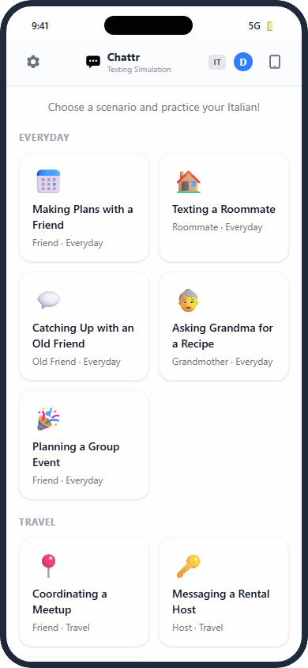
</p>

## Features

- **64 scenarios**: 8 scenario templates in 8 languages (English, Italian, Spanish, French,
  German, Chinese (Mandarin), Japanese, Korean). The templates are split into everyday
  conversations (making plans with a friend, texting a roommate, catching up with an old
  friend, asking grandma for a recipe, planning a group event) and travel (coordinating a
  meetup, messaging a rental host, asking a friend for recommendations).
- **Difficulty levels**: beginner, intermediate and advanced, which change how the character
  writes.
- **Grammar corrections** (optional): the character flags mistakes in your message, and the
  correction is attached to that message.
- **Reply hints** (optional, beginner level only): three suggested replies shown as tappable
  chips.
- **Tap-to-translate**: tap a character's message to toggle an English translation, which is
  cached after the first fetch.
- **Word bank**: long-press a message to look up and save words. Saved words are stored per
  account and can be browsed and searched at `/word-bank`.
- **Slang reference**: a per-language panel of common texting slang and abbreviations.
- **Report card**: when a conversation ends, the app shows your stats (exchanges, corrections
  received, hints used) and Gemini writes feedback: whether you met the scenario goal, grammar
  and vocabulary assessments, what went well and what to improve, and an overall rating. You
  can also export the transcript.
- **Guest demo mode**: signed-out visitors can play one scripted "Making Plans" conversation
  per language. It makes no Gemini calls.
- **Installable PWA**: web manifest, service worker and an offline fallback page.
- **Phone and tablet frames**: toggle between a 390px phone and an 820px tablet view.
- **UI localization**: optionally show the interface itself in the language you are
  practicing.
- Dark mode, font sizes and optional sound effects.

English is a special case: translation, word bank and slang features are hidden, since there
is nothing to translate to.

## Screenshots

The captures show the desktop layout, where the app runs inside a phone frame. On a phone it
fills the screen.

<table>
  <tr>
    <td align="center" valign="top" width="33%">
      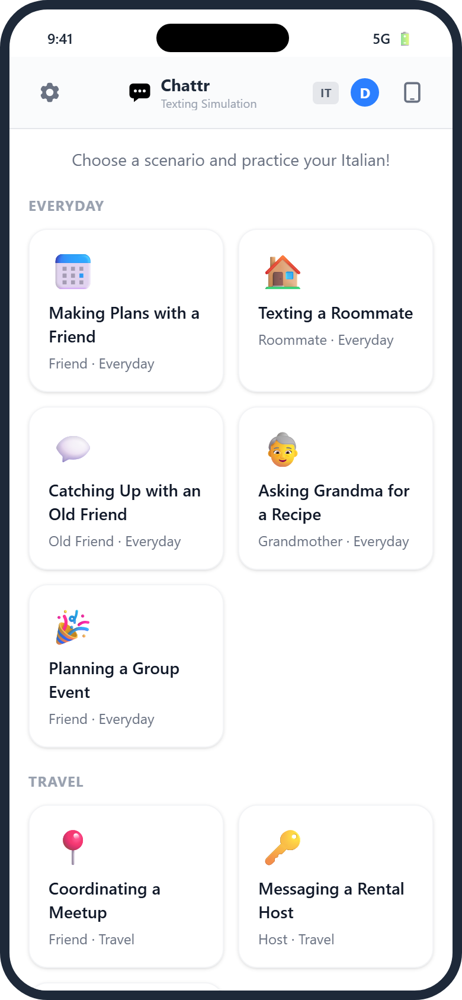<br>
      <sub><b>Scenarios</b>: pick a situation in the language you're practicing</sub>
    </td>
    <td align="center" valign="top" width="33%">
      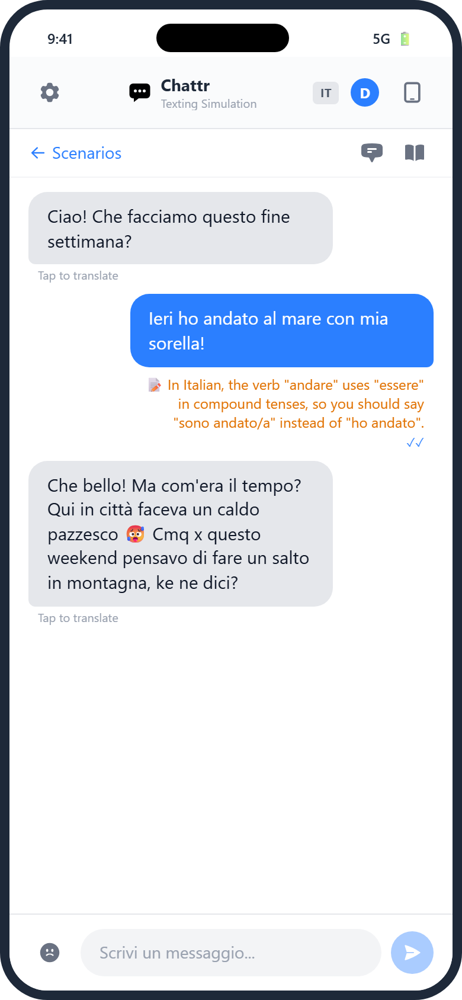<br>
      <sub><b>Grammar corrections</b> appear under your message</sub>
    </td>
    <td align="center" valign="top" width="33%">
      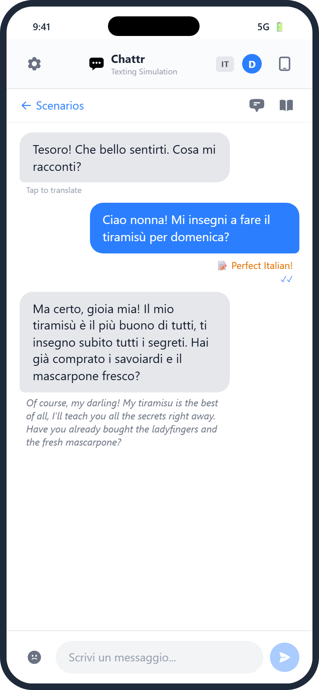<br>
      <sub><b>Tap to translate</b> any message into English</sub>
    </td>
  </tr>
  <tr>
    <td align="center" valign="top" width="33%">
      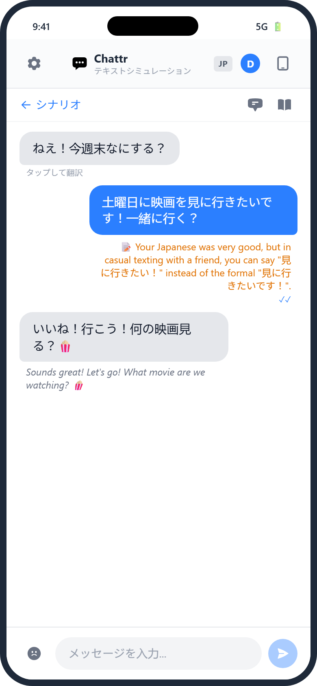<br>
      <sub><b>8 languages</b>, with the UI optionally in the target language</sub>
    </td>
    <td align="center" valign="top" width="33%">
      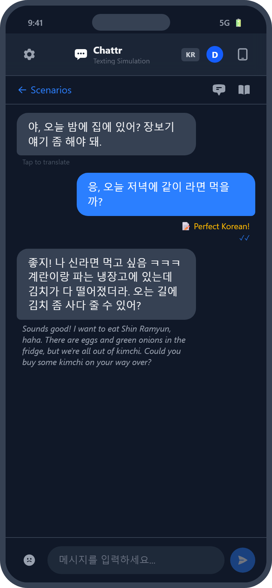<br>
      <sub><b>Dark mode</b></sub>
    </td>
    <td align="center" valign="top" width="33%">
      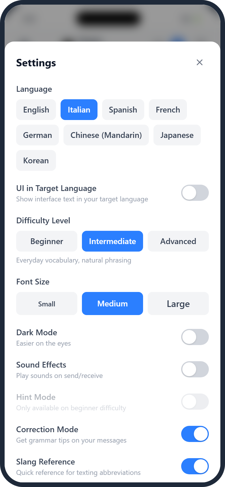<br>
      <sub><b>Settings</b></sub>
    </td>
  </tr>
</table>

### Reply hints (beginner level)

<table>
  <tr>
    <td align="center" valign="top" width="50%">
      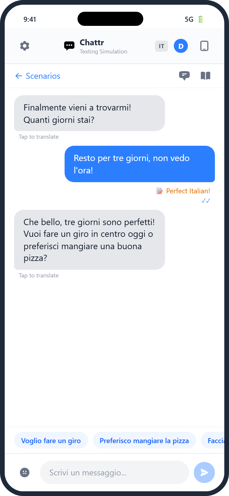<br>
      <sub>Suggested replies sit above the input bar</sub>
    </td>
    <td align="center" valign="top" width="50%">
      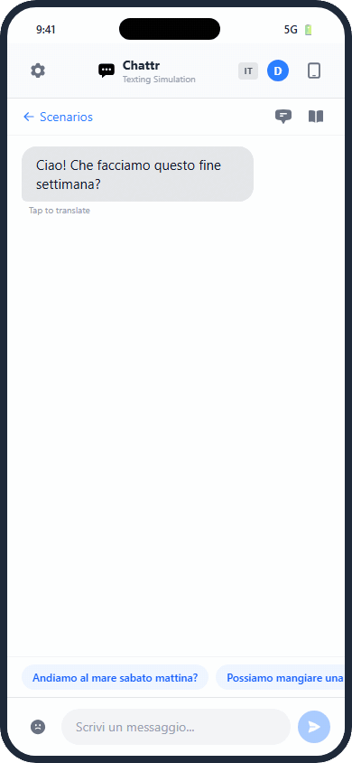<br>
      <sub>Tap one to send it; new hints follow each reply</sub>
    </td>
  </tr>
</table>

### Word bank

<table>
  <tr>
    <td align="center" valign="top" width="33%">
      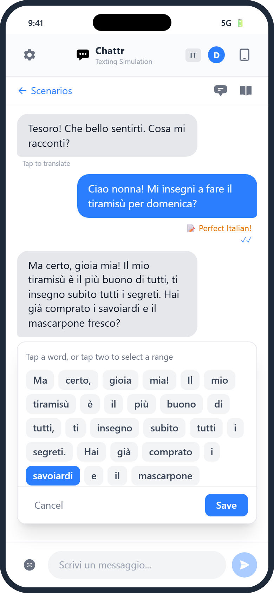<br>
      <sub>Long-press a message to pick words</sub>
    </td>
    <td align="center" valign="top" width="33%">
      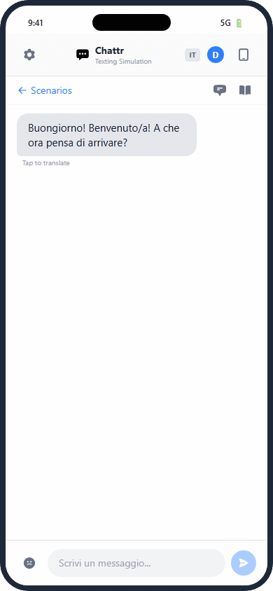<br>
      <sub>Select a word or a range, then save</sub>
    </td>
    <td align="center" valign="top" width="33%">
      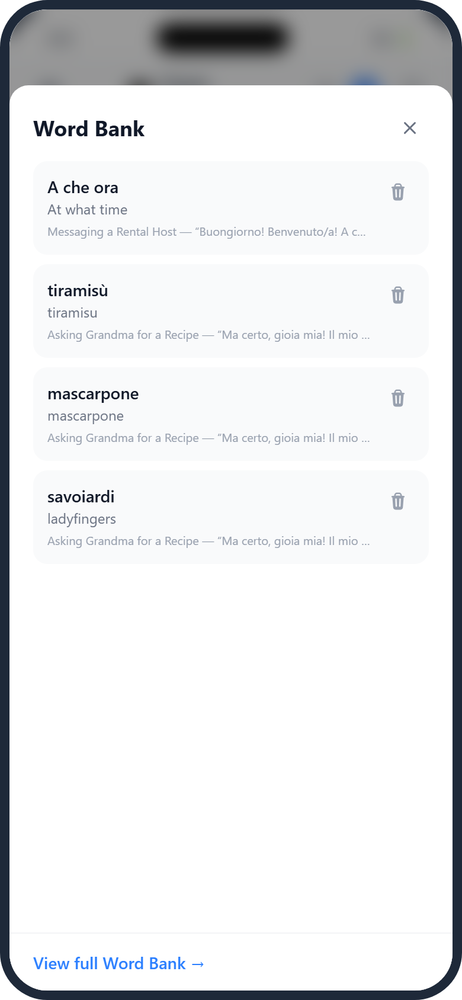<br>
      <sub>Saved words keep their meaning and context</sub>
    </td>
  </tr>
</table>

### Report card

<table>
  <tr>
    <td align="center" valign="top" width="50%">
      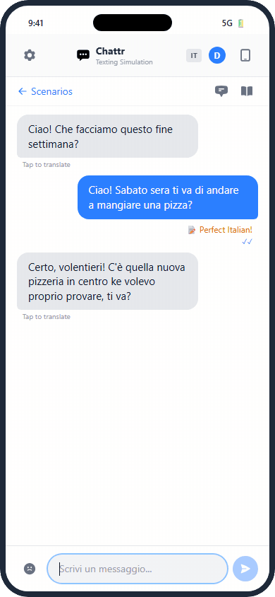<br>
      <sub>Agreeing on a plan ends the chat and the report loads</sub>
    </td>
    <td align="center" valign="top" width="50%">
      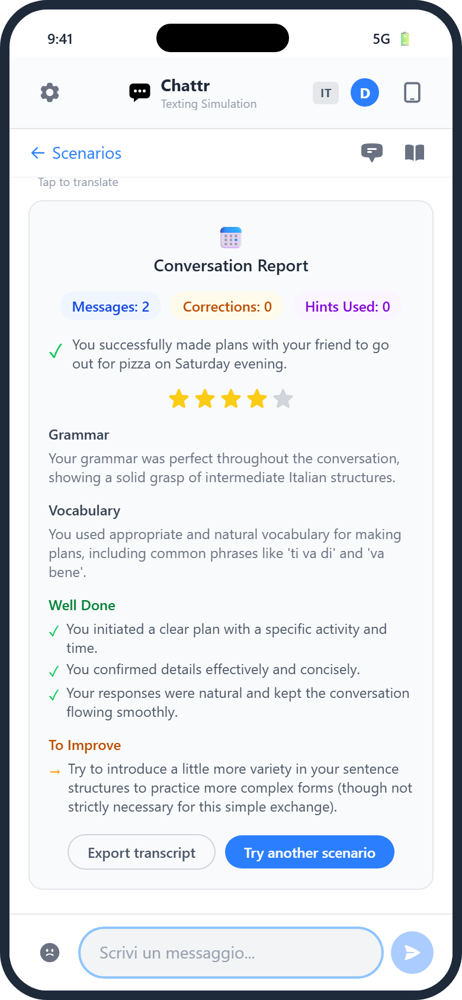<br>
      <sub>The full report</sub>
    </td>
  </tr>
</table>

## Tech stack

- [Next.js](https://nextjs.org) 16 (App Router), React 19, TypeScript
- Tailwind CSS 4
- Google Gemini via [`@google/genai`](https://www.npmjs.com/package/@google/genai)
- [Neon](https://neon.tech) Postgres with [Drizzle ORM](https://orm.drizzle.team)
- [Better Auth](https://www.better-auth.com) (email and password)
- Vitest for unit tests

## Setup

### Prerequisites

- Node.js 20.19+ or 22.12+ (the test tooling needs these; Next.js 16 itself needs 20.9+). A
  current LTS release is recommended.
- A Google Gemini API key
- A Neon Postgres database. Any Postgres should work, but the client is configured for
  Neon's pooled connection.

### 1. Get a Gemini API key

Create a key in [Google AI Studio](https://aistudio.google.com/apikey). Usage is billed to the
Google Cloud project behind the key, so check its pricing and quota settings before you invite
users.

### 2. Create a Neon database

Create a project at [neon.tech](https://neon.tech), then copy the **pooled** connection
string from the dashboard. The pooled host contains `-pooler`. The app uses
`prepare: false` for compatibility with Neon's pooler (PgBouncer in transaction mode).

### 3. Configure environment variables

```bash
cp .env.local.example .env.local
```

Fill in the four required values:

| Variable | Value |
|---|---|
| `GEMINI_API_KEY` | Your Gemini API key |
| `DATABASE_URL` | The pooled Neon connection string |
| `BETTER_AUTH_SECRET` | A random secret, e.g. `node -e "console.log(require('crypto').randomBytes(32).toString('base64url'))"` |
| `BETTER_AUTH_URL` | `http://localhost:3000` for local development |

To allow self-registration, also set `ALLOW_SIGNUP=true` (see
[Accounts and passwords](#accounts-and-passwords)).

### 4. Install and create the tables

```bash
npm install
npm run db:push
```

`db:push` runs `drizzle-kit push`. `drizzle.config.ts` loads `DATABASE_URL` from `.env.local`
unless it is already set in your shell, so exporting it is a way to target another database.

### 5. Create the first account

Sign-up is disabled by default, so accounts are created from the command line:

```bash
npx tsx --env-file=.env.local scripts/create-user.ts <email> "<name>" [password]
```

If you leave out the password, a random one is generated and printed once. Send it to the
user yourself; the app has no email provider.

If you set `ALLOW_SIGNUP=true`, this step is optional: you can register at `/auth/signup`
instead.

### 6. Run it

```bash
npm run dev
```

Open http://localhost:3000 and sign in.

### Accounts and passwords

Sign-up is off by default, on purpose. Every chat turn costs Gemini API usage, billed to
your key, so out of the box the app is invite-only: `/auth/signup` shows a notice, and Better
Auth's sign-up endpoint is disabled (`emailAndPassword.disableSignUp` in `src/lib/auth.ts`).
There is no admin UI.

To open registration, set `ALLOW_SIGNUP=true`. Only that exact value enables it; anything
else, including leaving it unset, keeps sign-up off. `/auth/signup` then shows a form (name,
email, password of at least 8 characters) and signs the new user in. Be aware that anyone who
finds an open deployment can create an account and run chats on your Gemini key, so set a
budget or quota on the key before you turn it on. The variable is read by the server at
runtime, so changing it needs a restart or redeploy, not a rebuild.

To reset a password:

```bash
npx tsx --env-file=.env.local scripts/reset-password.ts <email> [password]
```

This also revokes the user's existing sessions.

## Deploying to Vercel

1. Import the repository into Vercel.
2. Set `GEMINI_API_KEY`, `DATABASE_URL` and `BETTER_AUTH_SECRET` for all environments.
3. Set `BETTER_AUTH_URL` to your production origin (for example `https://chat.example.com`),
   **for the Production environment only**. Preview deployments then fall back to their own
   `VERCEL_URL`, so auth works on each preview without pointing back at production.
4. If users reach the app through additional origins, such as a custom domain alongside the
   default one or a branch alias, list them in `TRUSTED_ORIGINS` (comma-separated).
5. Optionally, set `ALLOW_SIGNUP=true` to open self-registration (see
   [Accounts and passwords](#accounts-and-passwords)). Leave it unset to stay invite-only.
   Vercel applies environment variable changes on the next deployment, so redeploy after
   changing it.

The trusted auth origins are `BETTER_AUTH_URL`, `https://$VERCEL_URL`, everything in
`TRUSTED_ORIGINS`, and `http://localhost:3000` / `http://localhost:3001`.

Run `db:push` against the production database once, as in step 4 above. Unless sign-up is
open, create accounts with `scripts/create-user.ts` pointed at that database's `DATABASE_URL`.

## Configuration

Optional environment variables, read in `src/lib/gemini.ts`:

| Variable | Used for | Default |
|---|---|---|
| `GEMINI_MODEL` | Chat, hints and translation | `gemini-2.5-flash` |
| `GEMINI_FEEDBACK_MODEL` | Report card | `gemini-2.5-flash` |
| `GEMINI_FEEDBACK_THINKING` | Report-card thinking level: `minimal`, `low`, `medium` or `high` | off |

With none set, every route uses `gemini-2.5-flash` with thinking disabled. Gemini 2.5 models
use a thinking-token budget, and later models use thinking levels. Thinking tokens count
against the output cap, so the app raises the caps for non-2.5 models or when report-card
thinking is on.

`TRUSTED_ORIGINS` is described under [Deploying to Vercel](#deploying-to-vercel).

Access control, read in `src/lib/signup.ts`:

| Variable | Used for | Default |
|---|---|---|
| `ALLOW_SIGNUP` | Self-registration at `/auth/signup`. Only the exact value `true` enables it | off (invite-only) |

## Scripts

| Command | What it does |
|---|---|
| `npm run dev` | Start the dev server on http://localhost:3000 |
| `npm run build` | Production build (needs `GEMINI_API_KEY` set, since the Gemini client is created at module load; the database is not contacted) |
| `npm start` | Serve the production build |
| `npm run lint` | ESLint |
| `npm test` | Run the Vitest unit tests once (`npm run test:watch` to watch) |
| `npm run db:push` | Push the Drizzle schema (`src/lib/db/schema.ts`) to the database |
| `npm run db:studio` | Open Drizzle Studio |

`scripts/compare-corrections.ts` is a developer tool for choosing a model. It sends each case in
`scripts/correction-cases.json` (learner messages with known errors) to one or more Gemini
models, using the same system prompt `/api/chat` builds with corrections on. It writes the raw
replies, token usage, latency and estimated cost to `scripts/output/` for a human to grade:

```bash
npx tsx --env-file=.env.local scripts/compare-corrections.ts [--runs 2] [--models a,b,c]
```

It makes real API calls and is billed like normal usage.

## Cost

Every signed-in chat turn calls Gemini. Hints, translations, word-bank lookups and the
end-of-conversation report card call it too. Guests only get the scripted demo
(`src/hooks/useDemoChat.ts`), which makes no Gemini calls, and all Gemini-backed API routes
require a signed-in session. That only limits cost while sign-up is off: with
`ALLOW_SIGNUP=true`, anyone who finds the site can create an account and use your key. Sessions are cached in a signed cookie for 5 minutes to reduce
database queries, since each query wakes a scaled-to-zero Neon compute.

See [`docs/diagnostics.md`](docs/diagnostics.md) for the logging and the failure-event table.

## License

[MIT](LICENSE)
